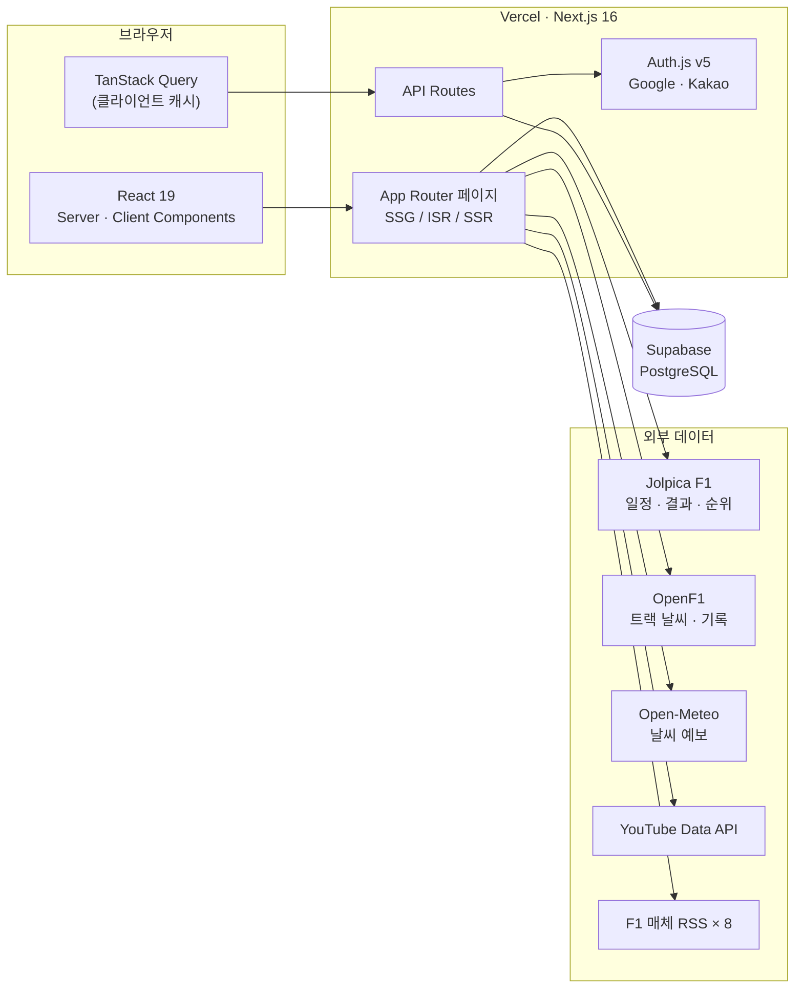

<div align="center">


# WhatisF1

### F1을 처음 보는 사람도, 매주 챙겨 보는 사람도 — 한국어로 보는 포뮬러 1의 모든 것

뉴스 · 하이라이트 · 경기 일정 · 레이스 결과 · 순위 · 입문 가이드 · 시즌 예측 투표를 한 곳에서

[](https://f1-web-delta.vercel.app)

[](https://nextjs.org)
[](https://react.dev)
[](https://www.typescriptlang.org)
[](https://tailwindcss.com)
[](https://tanstack.com/query)
[](https://supabase.com)
[](https://authjs.dev)

**[🏁 사이트 바로가기](https://f1-web-delta.vercel.app)** &nbsp; [](https://www.instagram.com/what_is_f1__)

</div>

---

## 📌 목차

- [프로젝트 소개](#-프로젝트-소개)
- [한눈에 보기](#-한눈에-보기)
- [아키텍처](#-아키텍처)
- [기술 스택](#-기술-스택)
- [렌더링 전략](#-렌더링-전략)
- [주요 기능](#-주요-기능)
- [성능 개선](#-성능-개선)
- [트러블슈팅](#-트러블슈팅)
- [데이터베이스](#-데이터베이스)
- [API Routes](#-api-routes)
- [시작하기](#-시작하기)
- [프로젝트 구조](#-프로젝트-구조)
- [로드맵](#-로드맵)

---

## 🏎 프로젝트 소개

F1 정보는 대부분 영어로 흩어져 있어서, 입문자가 "지금 무슨 일이 일어나고 있는지" 따라가기 어렵습니다.
**WhatisF1**은 해외 매체 뉴스를 한국어로 번역해 전하고, 일정·결과·순위·하이라이트를 한 사이트에 모은 **실제 운영 중인 팬 서비스**입니다.

바닐라 JS로 만들었던 첫 버전을 **Next.js App Router + TypeScript로 새로 설계해 다시 구현**했습니다.
화면만 옮기는 데서 그치지 않고 관리자 번역·승인 워크플로우, OAuth 로그인, 페이지별 캐시 전략, Supabase 기반 데이터 계층까지 직접 설계했습니다.

---

## ✨ 한눈에 보기

| | |
|:--|:--|
| 📄 **페이지** | 15개 (동적 라우트 포함) |
| 🔌 **API Route** | 8개 |
| 🌐 **외부 데이터 소스** | Jolpica F1 · OpenF1 · Open-Meteo · YouTube Data API v3 |
| 📰 **뉴스 수집** | 해외 F1 매체 RSS 8곳 → 관리자 번역 후 공개 |
| 🎬 **하이라이트** | YouTube 플레이리스트 40개 자동 수집 |
| 🗺 **서킷** | 2026 시즌 서킷 이미지 25개 + 공식 레이스 데이터 |
| 📊 **역대 순위** | 1950년~현재 드라이버·컨스트럭터 전 시즌 검색 |

---

## 🧭 아키텍처



- **읽기 데이터**(일정·결과·순위·하이라이트)는 서버 컴포넌트에서 가져와 ISR로 캐시합니다.
- **쓰기 데이터**(번역·공개·반응·투표·피드백)는 API Route를 거쳐 Supabase에 저장하고, 서비스 롤 키는 서버에서만 씁니다.

---

## 🛠 기술 스택

| 분류 | 기술 | 사용 이유 |
|:--|:--|:--|
| **Framework** | Next.js 16.2 (App Router) | 페이지마다 SSG / ISR / SSR을 골라 쓸 수 있음 |
| **Language** | TypeScript (strict) | 외부 API 응답이 많아서 타입으로 형태를 고정 |
| **UI** | React 19.2 | Server / Client Component 분리 |
| **Styling** | Tailwind CSS v4 + CSS Variables | 다크모드를 변수 오버라이드 하나로 처리 |
| **Server State** | TanStack Query v5 | 관리자 화면 동기화, 낙관적 업데이트 |
| **Auth** | Auth.js v5 (next-auth) | Google · Kakao OAuth, JWT 세션 |
| **Database** | Supabase (PostgreSQL) | 번역 기사 · 반응 · 투표 · 역대 순위 저장 |
| **Font** | Pretendard (Variable, `next/font/local`) | 한글 가독성, 자체 호스팅 |
| **Deploy** | Vercel | `main` push → 자동 배포 |
| **기타** | xml2js · flag-icons · tsx | RSS 파싱 · 국기 아이콘 · 시딩 스크립트 실행 |

---

## ⚡ 렌더링 전략

데이터가 **얼마나 자주 바뀌는지**를 기준으로 페이지마다 다르게 정했습니다.

| 전략 | 페이지 | 이유 |
|:--|:--|:--|
| **SSG** | `/guide` · `/policy/*` | 빌드 후 바뀌지 않는 정적 콘텐츠 |
| **ISR 5분** | `/news` · `/results` | 기사 공개를 빨리 보여줘야 하고, 레이스 직후 결과가 갱신됨 |
| **ISR 30분** | `/` (홈) | 뉴스·하이라이트 미리보기가 하루 몇 번 바뀜 |
| **ISR 1시간** | `/highlights` · `/schedules` · `/standings` | 레이스 주말 단위로만 바뀌는 데이터 |
| **동적 렌더링** | `/news/[slug]` · `/login` · `/signup` | 로그인 상태·관리자 여부에 따라 응답이 달라짐 |
| **CSR** | `/prediction` | localStorage와 세션 상태에 의존 |

기사를 공개하면 `revalidatePath('/news')`로 캐시를 바로 무효화합니다. ISR 주기를 기다리지 않고 몇 초 안에 반영돼요.

---

## 🧩 주요 기능

### 🏠 홈
- 다음 레이스까지 남은 시간을 초 단위로 보여주는 **카운트다운**
- 최신 뉴스 · 하이라이트 · 순위 TOP3 미리보기
- 입문자용 가이드 섹션, 시즌 예측 투표 배너
- 여러 데이터 소스를 `Promise.all`로 병렬 요청

### 📰 뉴스 — 수집부터 번역·공개까지
```
RSS 8곳 수집 → Supabase 저장 (기본 비공개) → 관리자 번역 → 공개 → 캐시 무효화 → 사용자 노출
```
- **수집 매체:** Autosport · Motorsport · BBC Sport · RaceFans · The Race · Crash.net · Motorsport Week · GPFans
- 날짜별 탭과 매체 필터, 가로 스크롤 UI
- **관리자 전용 인라인 번역 에디터:** 목록과 상세 화면에서 바로 제목·본문을 번역하고 공개
- 공개되지 않은 기사는 일반 사용자에게 `404`로 보이고, **7일이 지나면 자동 삭제**
- **상세 페이지 `/news/[slug]`:** 원문 URL을 URL-safe Base64 슬러그로 인코딩, 원문 링크 제공, 미번역 기사에는 `EN` 뱃지
- **이모지 반응:** 로그인 사용자 기준으로 토글(누르면 추가, 다시 누르면 취소), TanStack Query 낙관적 업데이트
- TanStack Query `staleTime: 30초`로 관리자 화면과 목록 상태 동기화

### 🎬 하이라이트
- **YouTube 플레이리스트 40개** 자동 수집
  - F1 공식 채널 (F1 · F2 · F3 · eSports)
  - 쿠팡플레이 — 영상 제목 키워드로 시즌·콘텐츠 종류 자동 감지
  - 국내 크리에이터 채널 3곳 (원투피니시 · Box to Pass · 퍼플섹터)
- `Promise.allSettled`로 수집해서 **채널 하나가 실패해도 나머지는 정상 노출**
- 시즌 / 콘텐츠 종류 / 채널 **3축 필터** + `useMemo`로 필터 결과 캐싱
- 쇼츠(60초 이하) 자동 분류, 슬라이더 ↔ 그리드 보기 전환
- 썸네일은 고화질(`maxresdefault`)을 먼저 쓰고, 없으면 `hqdefault`로 대체

### 📅 경기 일정
- 2025 / 2026 시즌 지원, `router.push`로 URL 쿼리(`?season=`)를 바꿔 시즌 전환
- Next.js 15+에서 Promise가 된 `searchParams`를 `await`로 처리
- 라운드별 카드: 서킷 · 국가 · 세션 시간 · 결과 페이지 바로가기

### 🏁 경기 결과
- **세션 탭:** 레이스 · 퀄리파잉 · 스프린트 · 연습주행 · 피트스탑 · 타이어 전략 (해당 라운드에 있는 세션만 표시)
- `Suspense`로 빠른 데이터부터 먼저 보여주고 느린 데이터는 이어서 로드
- **서킷 정보 카드:** 서킷 이미지, 공식 레이스 거리, 랩 수, 첫 그랑프리, 랩 레코드
- **랩 레코드:** Jolpica에서 해당 서킷의 역대 패스티스트 랩을 조회해 계산
- **트랙 날씨:**
  - 2023년 이후 지난 레이스: OpenF1 서킷 센서 실측값 (기온 · 트랙 온도 · 습도 · 풍속 · 강수)
  - 그 외: Open-Meteo (지난 레이스는 과거 기록, 다가올 레이스는 예보)
- **레이스 요약:** 완주 · DNF · 피트스탑 수 · 패스티스트 랩
- API가 주지 않는 항목(패스티스트 피트스탑 · 드라이버 오브 더 데이)은 `manualRaceData`로 따로 관리
- 시즌·라운드 드롭다운을 바꾸면 바로 해당 결과로 이동

### 🏆 순위
- 드라이버 / 컨스트럭터 탭, 팀 컬러 · 국기 · 드라이버 코드 표시
- **순위 변동:** 직전 라운드 순위와 비교해 ▲N / ▼N / — 표시
- **포디움 집계:** 레이스 결과에서 우승·포디움 횟수 계산
- 드라이버·팀 이름 한국어 표기
- 컨스트럭터 챔피언십이 생기기 전(1958년 이전) 시즌을 고르면 컨스트럭터 탭 자동 비활성화
- 스켈레톤 로딩 UI (`loading.tsx`)
- **역대 시즌 검색 (1950~현재):** 한국어·영어 이름으로 검색하면 시즌별 순위 추이 카드로 보여줌
  - 미리 시딩해 둔 Supabase 테이블을 조회해서 **약 70초 → 약 2초**로 단축

### 🗳 시즌 예측 투표
- 2026 시즌 질문 10개 — 단일 선택 · 복수 선택 · 순위 매기기 3가지 유형
- **오프라인 우선:** 답변을 localStorage에 바로 저장하고, 로그인하면 서버와 동기화
- 마지막 입력 후 0.8초 뒤에 저장하는 **디바운스 동기화**, `upsert`로 생성·수정 통합
- 문항별 제출 후 잠금, 전체 초기화
- 단일 선택은 다시 누르면 선택 해제, 복수 선택은 문항마다 최대 개수 제한
- 드라이버·팀 공식 컬러를 쓴 선택 카드

### 📚 입문 가이드
- 기초 지식 · 팀 가이드 · 드라이버 가이드 · 2026 규정 **4개 탭**
- **용어 툴팁 (`Term` 컴포넌트):** 본문 속 전문 용어에 점선 밑줄, 올리면 설명 팝업 (용어 21개)

### 🔐 인증 · 공통
- Google · Kakao OAuth, 관리자 이메일 기반 권한 구분
- JWT의 `sub`를 `session.user.id`로 넣어 Supabase 데이터와 사용자 연결
- `Providers.tsx`에서 `SessionProvider` + `QueryClientProvider`로 앱 전체를 감쌈
- 3열 헤더 그리드 (로고 · 네비게이션 · 사용자 영역)
- 다크모드: `<head>` 인라인 스크립트로 테마를 먼저 적용해서 **깜빡임(FOUC) 방지**
- 인앱 브라우저(카카오톡·인스타그램 등) 감지 안내 — 인앱 브라우저에서는 OAuth가 막히는 경우가 있어서
- 피드백 제출: IP 해시 기반 **시간당 3회 제한**
- 로딩 스켈레톤, 접근성(aria) 속성 정리

---

## 🚀 성능 개선

| 항목 | Before | After | 방법 |
|:--|:--:|:--:|:--|
| 역대 순위 검색 응답 | ~70초 | **~2초** | 시즌마다 외부 API 호출 → Supabase 사전 시딩 테이블 1회 조회 |
| 역대 순위 검색 API 호출 | ~150회 | **1회** | `npm run seed:standings`로 1950년~현재 데이터를 미리 적재 |
| 하이라이트 채널 장애 | 페이지 전체 실패 | **실패한 채널만 제외** | `Promise.all` → `Promise.allSettled` |
| 결과 페이지 첫 화면 | 모든 데이터 대기 | **빠른 데이터 먼저 표시** | `Suspense` 경계 분리 |
| 서킷 이미지 LCP | 지연 로드 | **즉시 로드** | `next/image` `priority` 적용 |
| 레이스 거리 정확도 | 계산값 (최대 1.5km 오차) | **공식값** | formula1.com 공식 데이터 사용 |

---

## 🔧 트러블슈팅

<details>
<summary><b>순위·결과·하이라이트 페이지가 한꺼번에 500 에러</b></summary>

- **원인:** 팀 컬러 상수를 두 모듈이 서로 import하는 **순환 의존성** → 한쪽이 `undefined`로 평가됨
- **해결:** `src/lib/teamColors.ts`로 분리해서 의존 방향을 한쪽으로 정리
</details>

<details>
<summary><b>Vercel 배포 후 OAuth 로그인 콜백이 localhost로 이동</b></summary>

- **원인:** Vercel 프록시 뒤에서 Auth.js가 요청 Host 헤더를 신뢰하지 않음
- **해결:** Auth.js 설정에 `trustHost: true`
</details>

<details>
<summary><b>관리자가 공개한 기사가 일반 사용자에게 안 보임</b></summary>

- **원인:** 기존 행 Map(`rowMap`)을 만든 **뒤에** 새 기사를 INSERT해서, Map에 없는 기사의 공개 여부가 잘못된 기본값으로 판정됨
- **해결:** 기본값 처리를 바로잡고, 공개할 때 `revalidatePath`로 캐시 무효화
</details>

<details>
<summary><b>검색어에 <code>,</code> <code>(</code> <code>)</code>가 들어가면 Supabase 쿼리 오류</b></summary>

- **원인:** PostgREST `or()` 필터 문법에서 쉼표·괄호를 구분자로 해석
- **해결:** 검색어에서 해당 문자를 제거하고, `%` `_`는 이스케이프해서 `ilike` 와일드카드로 오작동하지 않게 처리
</details>

<details>
<summary><b>가이드 페이지 <code>Hydration failed</code></b></summary>

- **원인:** `<p>` 안에 툴팁 컴포넌트의 `<div>`가 들어가 HTML 중첩 규칙 위반
- **해결:** `Term` 컴포넌트를 인라인 요소(`<span>`)로 교체
</details>

<details>
<summary><b>아우디 팀 컬러가 형광 초록으로 표시됨</b></summary>

- **원인:** 팀 컬러 정의가 여러 파일에 흩어져 있어서 값이 서로 어긋남
- **해결:** 단일 소스로 통일
</details>

---

## 🗄 데이터베이스

| 테이블 | 용도 |
|:--|:--|
| `news_translations` | RSS 기사 캐시 + 한국어 번역 + 공개 여부 |
| `news_reactions` | 기사별 이모지 반응 (사용자당 토글) |
| `season_predictions` | 시즌 예측 투표 답변 (사용자 + 시즌 단위) |
| `f1_standings` | 1950년~현재 드라이버·컨스트럭터 시즌 순위 |
| `feedbacks` | 사용자 피드백 (IP 해시로 제출 횟수 제한) |

<details>
<summary><code>f1_standings</code> 스키마</summary>

```sql
CREATE TABLE f1_standings (
  id            BIGSERIAL PRIMARY KEY,
  type          TEXT    NOT NULL CHECK (type IN ('driver', 'constructor')),
  entity_id     TEXT    NOT NULL,
  name          TEXT,               -- 한국어 이름
  original_name TEXT,               -- 영어 원문
  year          INT     NOT NULL,
  position      INT,
  points        NUMERIC NOT NULL DEFAULT 0,
  wins          INT     NOT NULL DEFAULT 0,
  team          TEXT,
  team_color    TEXT    NOT NULL DEFAULT '#888888'
);

CREATE UNIQUE INDEX f1_standings_unique ON f1_standings (type, entity_id, year);
CREATE        INDEX f1_standings_name   ON f1_standings (name);
CREATE        INDEX f1_standings_orig   ON f1_standings (original_name);
```
</details>

---

## 🔌 API Routes

| 엔드포인트 | 메서드 | 권한 | 용도 |
|:--|:--:|:--:|:--|
| `/api/auth/[...nextauth]` | GET · POST | — | OAuth 로그인 처리 |
| `/api/news/translate` | PATCH | 관리자 | 번역 저장 |
| `/api/news/publish` | PATCH | 관리자 | 기사 공개 + 캐시 무효화 |
| `/api/news/react` | POST | 로그인 | 이모지 반응 토글 |
| `/api/news/reactions` | GET | — | 기사별 반응 조회 |
| `/api/standings/search` | GET | — | 역대 순위 검색 |
| `/api/prediction` | GET · POST | 로그인 | 예측 투표 조회 · 저장 |
| `/api/feedback` | POST | — | 피드백 제출 (시간당 3회) |

---

## 💻 시작하기

```bash
git clone https://github.com/JANG-3584765/whatisf1.git
cd whatisf1
npm install
npm run dev          # http://localhost:3000
```

| 스크립트 | 설명 |
|:--|:--|
| `npm run dev` | 개발 서버 |
| `npm run build` | 프로덕션 빌드 |
| `npm run start` | 빌드 결과 실행 |
| `npm run lint` | ESLint 검사 |
| `npm run seed:standings` | 역대 순위를 Supabase에 적재 (처음 한 번, 이후 시즌 종료마다) |

### 환경 변수

프로젝트 루트에 `.env.local`을 만들고 아래 값을 채워 주세요.

```env
# Auth.js
AUTH_SECRET=
AUTH_GOOGLE_ID=
AUTH_GOOGLE_SECRET=
AUTH_KAKAO_CLIENT_ID=
AUTH_KAKAO_CLIENT_SECRET=

# Supabase (서버 전용)
SUPABASE_URL=
SUPABASE_SERVICE_ROLE_KEY=

# 외부 API
YOUTUBE_API_KEY=

# 관리자 · 사이트
ADMIN_EMAIL=
NEXT_PUBLIC_SITE_URL=
```

---

## 📁 프로젝트 구조

```
src/
├─ app/
│  ├─ (main)/            # 사용자 페이지 (홈 · 뉴스 · 하이라이트 · 일정 · 결과 · 순위 · 가이드 · 투표 · 정책)
│  ├─ api/               # API Routes
│  ├─ layout.tsx         # 전역 레이아웃 · 폰트 · 테마 초기화
│  └─ globals.css        # CSS 변수 · 다크모드
├─ components/
│  ├─ home/              # 홈 섹션
│  ├─ guide/             # 가이드 탭
│  ├─ layout/            # 헤더 · 푸터 · Provider
│  └─ ui/                # 공용 UI (Skeleton · Term · 썸네일)
├─ data/                 # 정적 데이터 (2026 로스터 · 가이드 · 용어 · 일정 · 채널)
├─ lib/                  # 외부 API 클라이언트 · Supabase · 유틸
└─ auth.ts               # Auth.js 설정
scripts/                 # 역대 순위 시딩 스크립트
```

---

## 🗺 로드맵

- [x] 뉴스 상세 페이지 + 이모지 반응
- [x] 홈 입문자 가이드 섹션
- [x] 역대 순위 고속 검색 (Supabase 시딩)
**기능**
- [ ] 하이라이트 키워드 검색
- [ ] 뉴스 UI/UX 재설계, 초기 로드 성능 개선
- [ ] 결과 페이지 — 라운드별 챔피언십 순위 변동, 드라이버별 포디움·우승 통계
- [ ] 패스티스트 피트스탑 데이터 자동화 (현재 수동 입력)

**코드 품질**
- [ ] 공통 컴포넌트 추출
- [ ] API 응답 타입 통합 (`src/types/`)
- [ ] 에러 바운더리와 폴백 UI 보강
- [ ] 이미지 lazy loading 개선
- [ ] 레이트 리밋 유틸을 다른 쓰기 API에도 적용

**인프라**
- [ ] Supabase Edge Function으로 RSS 수집 자동화

---

## ⚖️ 법적 고지

WhatisF1은 팬이 만든 **비공식** 프로젝트이며 Formula 1®, FIA, 어떤 F1 팀과도 제휴 관계가 없습니다.
모든 상표 · 로고 · 브랜드명의 권리는 각 권리자에게 있습니다.

<div align="center">

<br/>

**[🏁 WhatisF1 바로가기](https://f1-web-delta.vercel.app)**

[](https://www.instagram.com/what_is_f1__)

© 2026 WhatisF1

</div>
